

<h1 align="center">Colony Survival — Lab Xmas Edition 🎄</h1>

<a href="README.md">한국어</a> · <b>English</b>

**Christmas Eve, the lab is empty — the cells are pulling the night shift.**

Start in a petri dish and fight your way through the clean bench, the PCR room, the sequencing room and the analysis server room. Get past contaminants and experimental artifacts, and win an Accept from **Reviewer #2** waiting at the end. It is an auto-attack survival roguelike: you only move and dash, your weapons fire on their own, and every level-up lets you pick one of three options, so each run builds differently.

The game is playable in English — switch it under **Settings → Language**. (Screenshots below show the Korean UI.)

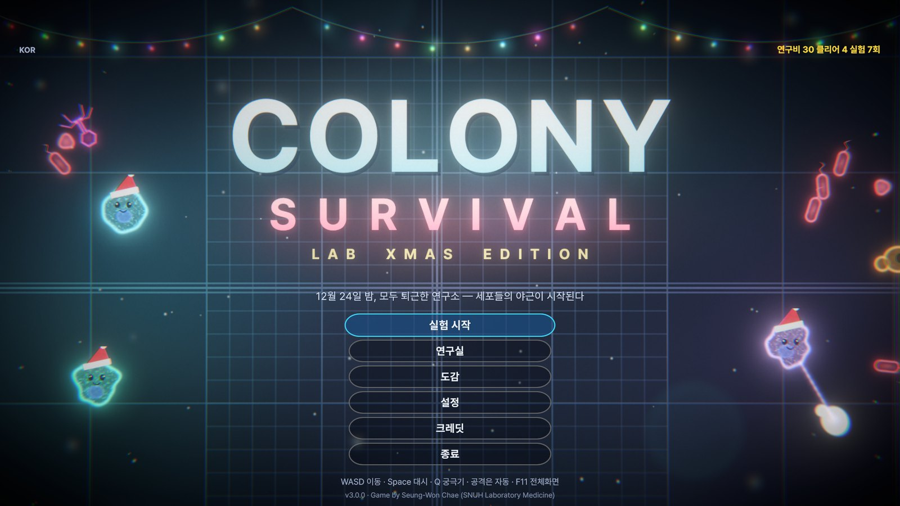

## Download

**[Get the latest version from Releases](https://github.com/CleanCham-lab/ColonySurvival/releases/latest)** — nothing else to install.

| OS | File | How to run |
| --- | --- | --- |
| Windows 10/11 (64-bit) | `ColonySurvival_v3.0.0_Windows.zip` | Unzip and double-click `ColonySurvival.exe`. If the blue "Windows protected your PC" window appears, click **More info → Run anyway** |
| macOS 12 or later, Apple Silicon (M1 and newer) | `ColonySurvival_v3.0.0_macOS_AppleSilicon.zip` | Unzip and double-click `Colony Survival.app`. See "First launch on a Mac" below |
| macOS 12 or later, Intel | `ColonySurvival_v3.0.0_macOS_Intel.zip` | Same as above |

Not sure which Mac build you need? Open the Apple menu → **About This Mac**. "Chip: Apple M…" means Apple Silicon; "Processor: Intel…" means Intel.

### First launch on a Mac

The app is not signed with a developer certificate, so macOS blocks it the first time.

1. Double-click `Colony Survival.app`. A warning says the developer cannot be verified or the app cannot be opened. Click **Done**.
2. Open **System Settings → Privacy & Security** and click **Open Anyway** near the bottom.
3. From then on it opens normally.

If you prefer the terminal, this one line does the same: `xattr -dr com.apple.quarantine "Colony Survival.app"`

Progress (grant money, unlocks, codex, settings) is saved automatically.

## Screenshots

| | |
| --- | --- |
| 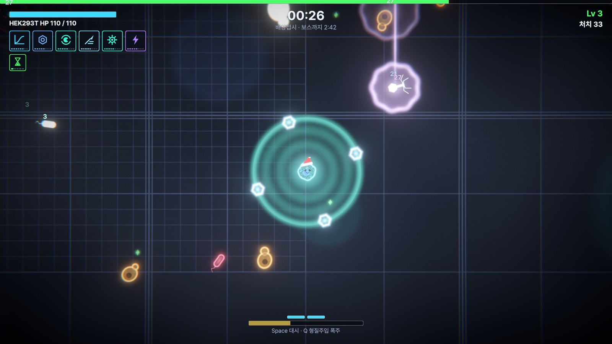 | 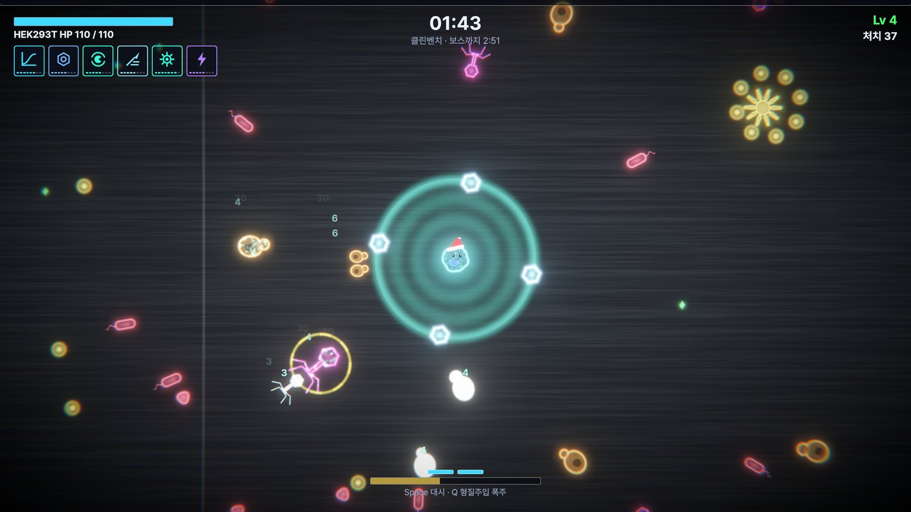 |
| Zone 1 — Petri Dish | Zone 2 — Clean Bench: laminar flow and the UV lamp |
| 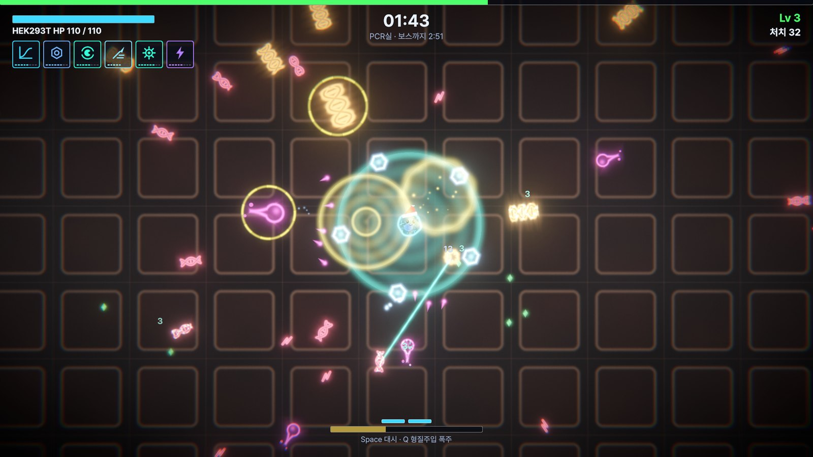 | 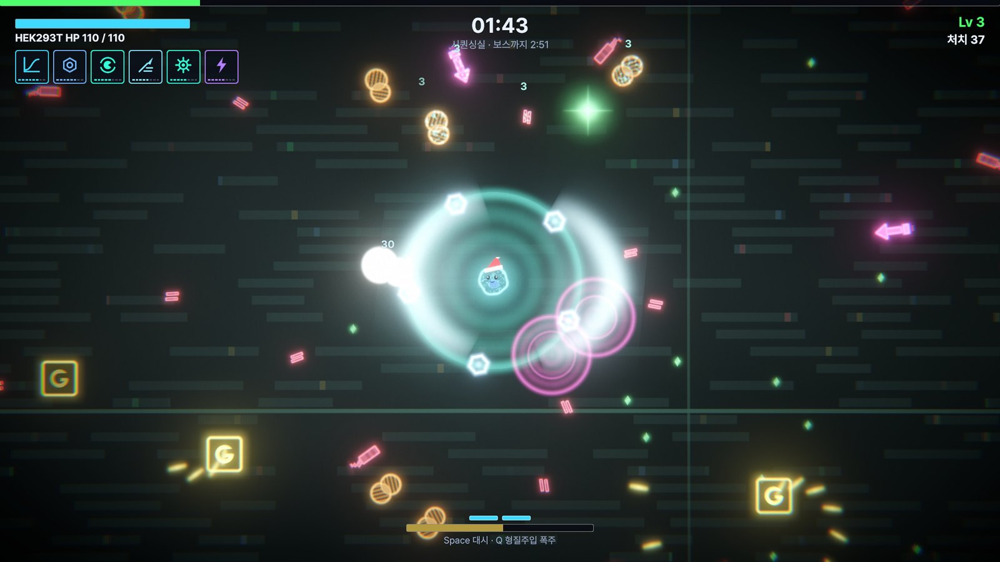 |
| Zone 3 — PCR Room: heating blocks that glow red-hot | Zone 4 — Sequencing Room · Short-read |
| 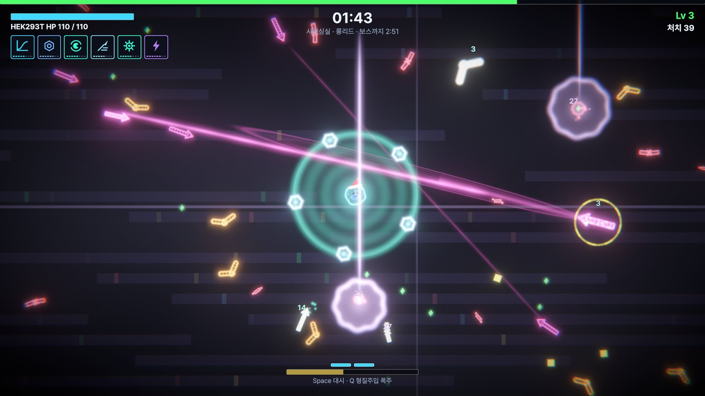 | 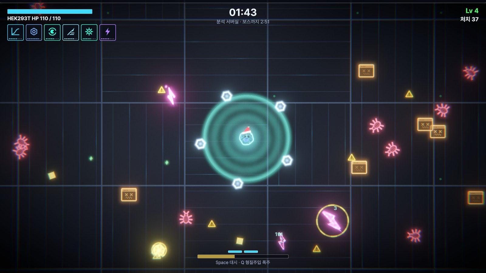 |
| Zone 4 — Sequencing Room · Long-read | Zone 5 — Analysis Server Room |
| 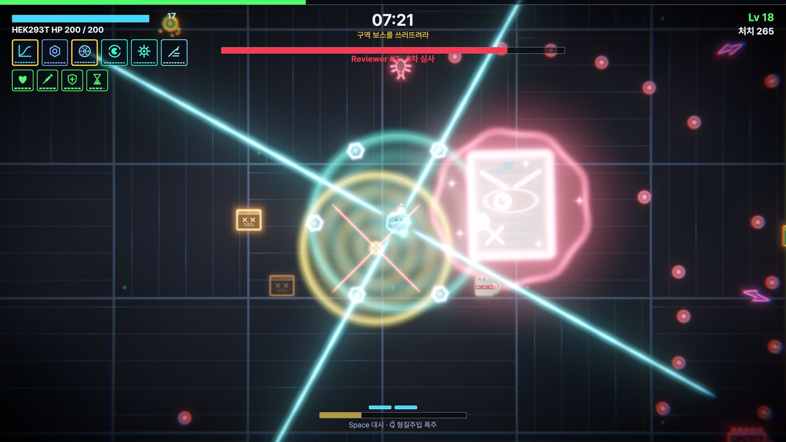 | 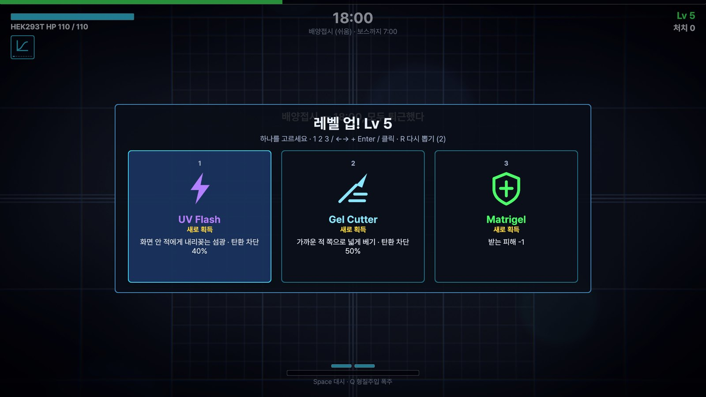 |
| Final boss Reviewer #2 — Second Round of Review | Level up: pick one of three |
| 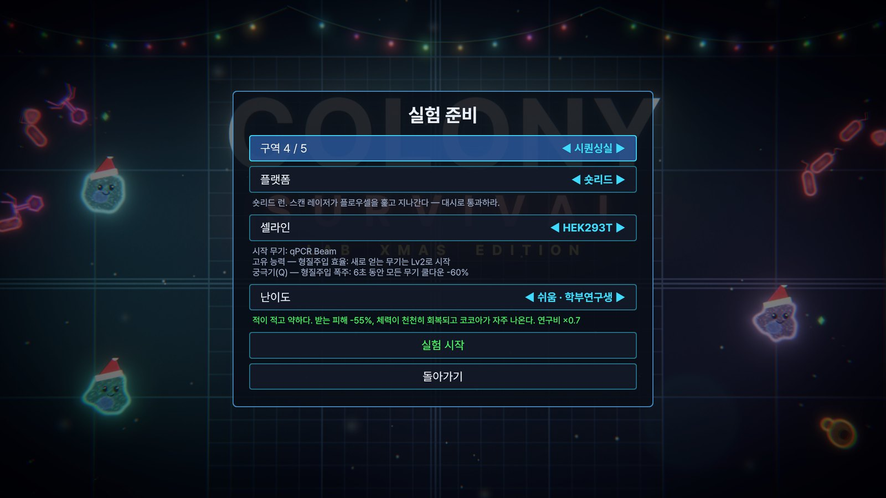 | 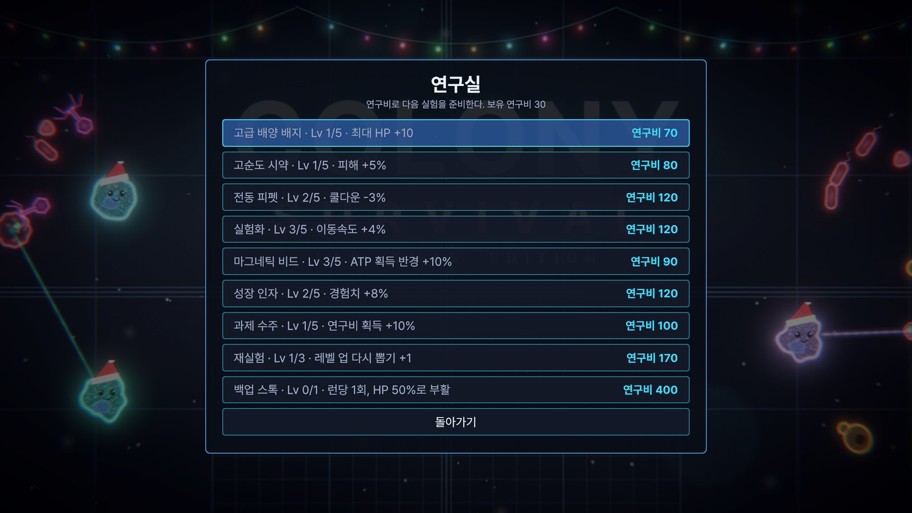 |
| Experiment Prep (zone, cell line, difficulty) | Lab (permanent upgrades) |

## How to play

- **Just move and dash.** Each weapon fires automatically on its own cooldown.
- Pick up the **ATP (green crystals)** enemies drop to level up, then choose a new weapon, a weapon upgrade or a reagent (press R to reroll).
- **Dash (Space)** makes you leap a short distance and you are invulnerable while dashing. When the gauge is full, press **Q** for your cell line's ultimate.
- Some weapons **erase enemy bullets by chance** (Nanopore Ring 75%, Centrifuge Wave 60%, and so on — listed in the codex).
- Break tip boxes for **hot cocoa (heals HP)** or a vortex. **Gift boxes** from elites and bosses grant several upgrades at once, and weapons **evolve** when their condition is met.
- When a zone's timer runs out, its **boss** appears. Beat it to unlock the next zone.
- After each run you earn **grant money** to spend on permanent upgrades in the Lab.

### Controls

| Input | Action |
| --- | --- |
| WASD / arrow keys / gamepad left stick | Move |
| Space · Left Shift / gamepad A · RT | Dash |
| Q · E / gamepad Y · LT | Ultimate |
| 1 · 2 · 3 / ←→ + Enter / mouse | Choose a level-up option |
| R | Reroll the options |
| Esc / P | Pause |
| F11 (Windows) · ⌘ + Ctrl + F (Mac) | Fullscreen (also in Settings) |

### What the colors mean

Like a fluorescence microscope, color is the rule.

| Color | Meaning |
| --- | --- |
| Blue · cyan (DAPI) | You and your weapons |
| Green (GFP) | Things to pick up — ATP, gift boxes |
| Red · orange · magenta (mCherry) | Enemies and their attacks |
| Yellow (YFP) | A warning that an attack is coming, and elites (in zones 3–5 warnings take the color of the attacking enemy) |

## Campaign

| Zone | Gimmick | What you fight | Boss |
| --- | --- | --- | --- |
| 1. Petri Dish | A wide dish for learning the basics | Contaminants | **Mold Wreath** |
| 2. Clean Bench | Laminar flow pushes you down and the UV lamp sweeps the bench | Contaminants | **Krampus Phage** |
| 3. PCR Room | Heating blocks flare up with each thermal cycle | PCR products | **Reviewer #1** — Minor Revision |
| 4. Sequencing Room | Choose **Short-read** (scanning laser) or **Long-read** (very long reads crossing the zone) | Sequencing artifacts | **Adapter Dimer** / **Concatemer** |
| 5. Analysis Server Room | Data packets race along the tile seams | Server errors | **Reviewer #2** — empty the health bar and the second round of review begins |

Each room spawns the kind of trouble that room would actually produce, and they all attack differently.

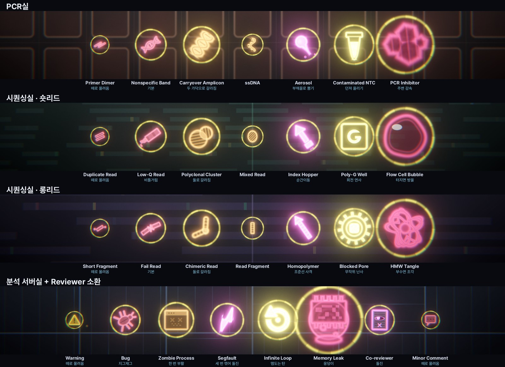

## Content

| Item | Details |
| --- | --- |
| 3 cell lines | **HEK293T** (new weapons start at Lv2 · ultimate Transfection Surge) · **HeLa** (Immortalization: revive once · ultimate Endless Proliferation) · **RAW 264.7** (heals on kills · ultimate Phagocytic Burst — unlocked by clearing zone 1) |
| 10 weapons + 4 evolutions | qPCR Beam, Gel Cutter, CRISPR Lance, Lentiviral Orb, Nanopore Ring, Lysozyme Field, 70% EtOH Splash, UV Flash, Antibody Chain, Centrifuge Wave → Real-time Thermocycler · Prime Editor · Pandemic Vector · Ultracentrifuge |
| 8 reagents (passives) | FBS, Pen-Strep, Trypsin, Agarose, DMSO, Matrigel, EGF, Lipofectamine |
| 32 enemies + elites | 6 contaminants · 6 PCR products · 6 short-read artifacts · 6 long-read artifacts · 6 server errors · 2 summoned by the Reviewers |
| 6 bosses | Mold Wreath · Krampus Phage · Reviewer #1 · Adapter Dimer · Concatemer · Reviewer #2 (two stages) |
| 3 difficulties | Easy (Undergrad Intern) · Normal (Grad Student) · Hard (Reviewer Mode, grant ×1.5) |
| 9 permanent Lab upgrades | Max HP, damage, cooldown, move speed, ATP pickup radius, experience, grant money, rerolls, revive (Backup Stock) |
| Codex | Records every enemy, boss, weapon and reagent you have met |
| Languages | Korean / English (switch in Settings) |
| Settings | Language, master · music · SFX volume, graphics level (5 levels including Auto), fullscreen · damage numbers and screen shake in the pause menu |

## What changed from v2

v3.0.0 is a **from-scratch remake in Unity 6** of v2, which was built with Godot 4.

| | v2.0.1 | v3.0.0 |
| --- | --- | --- |
| Engine | Godot 4 | Unity 6 |
| Structure | One 15-minute run + 2 stages | 5-zone campaign (each zone has its own gimmick, enemies and boss) |
| Controls | Move | Move + dash + ultimate |
| Enemies · bosses | 6 enemies, 3 bosses | 32 enemies, 6 bosses (Reviewer #2 has two stages) |
| Music | Run music + boss music | Music per zone, with instruments layering in as tension rises |
| Languages | Korean | Korean / English |
| Mac | One universal build | Separate Apple Silicon and Intel builds |

### Earlier versions

Earlier versions remain available.

- [v2.0.1](https://github.com/CleanCham-lab/ColonySurvival/releases/tag/v2.0.1) — the Godot 4 version (macOS 10.13 or later, supports older Intel Macs; Korean only)
- [Conoly_v1.0.0](https://github.com/CleanCham-lab/ColonySurvival/releases/tag/Conoly_v1.0.0) — the December 2025 alpha (Python + pygame)

## Changelog

- **v3.0.0** (2026-11-22) — the 5-zone campaign remake in Unity
- **v2.0.1** (2026-11-13) — fixed a crash on launch on older Intel Macs (such as the 2015 MacBook Pro)
- **v2.0.0** (2026-11-13) — the full redesign released

## Save location and play log

- Windows: `%USERPROFILE%\AppData\LocalLow\CleanCham-lab\Colony Survival\`
- macOS: `~/Library/Application Support/CleanCham-lab/Colony Survival/`

`save.json` (your progress) and `playlog.jsonl` (a summary of each run: zone, difficulty, survival time, hits taken and so on) are stored here. These files stay on your computer and are never sent anywhere.

## Credits

- Development · music · art: **Seung Won Chae (채승원)**
- Affiliation: Department of Laboratory Medicine, Seoul National University Hospital · Cancer Research Institute, Seoul National University
- Email: csm0578@naver.com/snu.ac.kr

## License

- Game code, graphics and music: [MIT License](LICENSE) © 2025-2026 Seung Won Chae
- Font: Pretendard © Kil Hyung-jin, SIL Open Font License 1.1 (`Assets/Resources/Fonts/Pretendard-OFL.txt`)
- Engine: Unity 6
