

<h1 align="center">Colony Survival — Lab Xmas Edition 🎄</h1>

<b>한국어</b> · <a href="README.en.md">English</a>

**12월 24일 밤, 모두 퇴근한 연구소 — 세포들의 야근이 시작된다.**

배양접시에서 출발해 클린벤치, PCR실, 시퀀싱실, 분석 서버실까지. 오염균과 실험 아티팩트를 뚫고, 마지막에 기다리는 **Reviewer #2**에게서 Accept를 받아 내는 자동공격 서바이벌 로그라이크입니다. 이동과 대시만 하면 무기는 알아서 쏘고, 레벨업마다 3개 중 하나를 골라 매판 다른 빌드를 만듭니다.

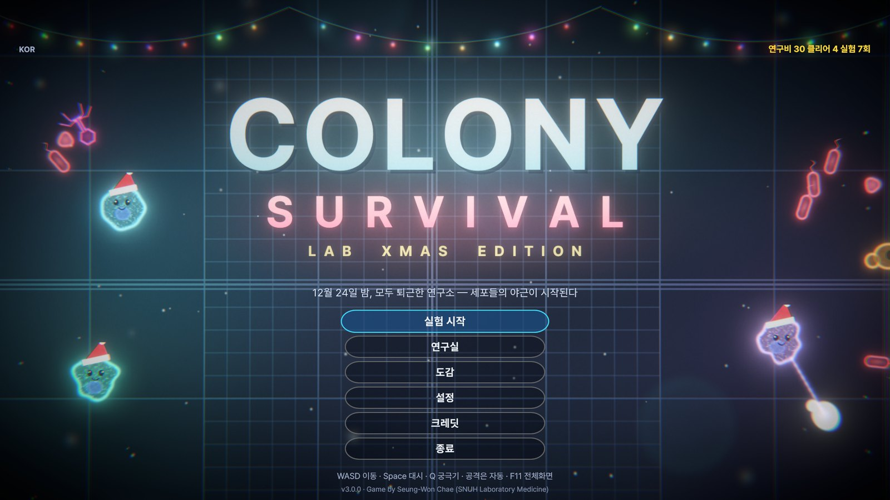

## 다운로드

**[Releases에서 최신 버전 받기](https://github.com/CleanCham-lab/ColonySurvival/releases/latest)** — 따로 설치할 프로그램은 없습니다.

| OS | 파일 | 실행 방법 |
| --- | --- | --- |
| Windows 10/11 (64비트) | `ColonySurvival_v3.0.0_Windows.zip` | 압축을 풀고 `ColonySurvival.exe` 더블클릭. 파란 "Windows의 PC 보호" 창이 뜨면 **추가 정보 → 실행** |
| macOS 12 이상, Apple Silicon (M1~) | `ColonySurvival_v3.0.0_macOS_AppleSilicon.zip` | 압축을 풀고 `Colony Survival.app` 더블클릭. 아래 "Mac에서 처음 열 때" 참고 |
| macOS 12 이상, Intel | `ColonySurvival_v3.0.0_macOS_Intel.zip` | 위와 같음 |

어느 Mac용을 받을지 모르겠다면 화면 왼쪽 위 Apple 메뉴 → **이 Mac에 관하여**에서 "칩: Apple M…"이면 Apple Silicon, "프로세서: Intel…"이면 Intel용입니다.

### Mac에서 처음 열 때

개발자 서명이 없는 앱이라 처음 한 번은 macOS가 막습니다.

1. `Colony Survival.app`을 더블클릭하면 "확인되지 않은 개발자" 또는 "열 수 없습니다" 경고가 뜹니다. **완료**를 누릅니다.
2. **시스템 설정 → 개인정보 보호 및 보안**을 열고 아래쪽의 **그래도 열기**를 누릅니다.
3. 다음부터는 그냥 열립니다.

터미널이 편하면 `xattr -dr com.apple.quarantine "Colony Survival.app"` 한 줄로도 됩니다.

저장(연구비·해금·도감·설정)은 자동으로 됩니다.

## 스크린샷

| | |
| --- | --- |
| 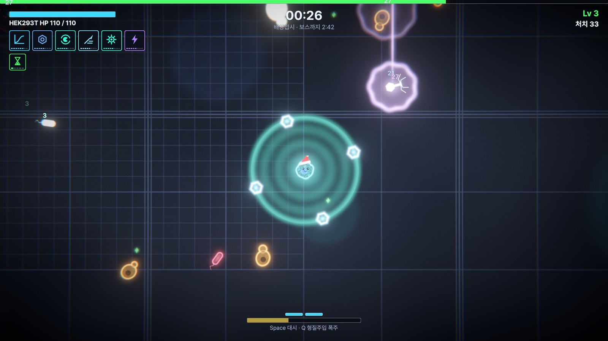 | 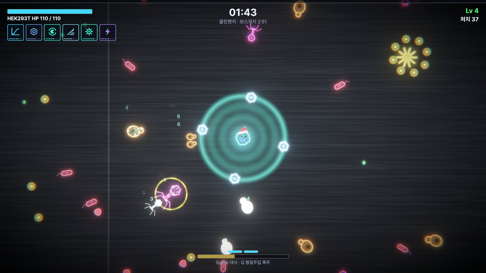 |
| 1구역 배양접시 | 2구역 클린벤치 — 층류와 UV 램프 |
| 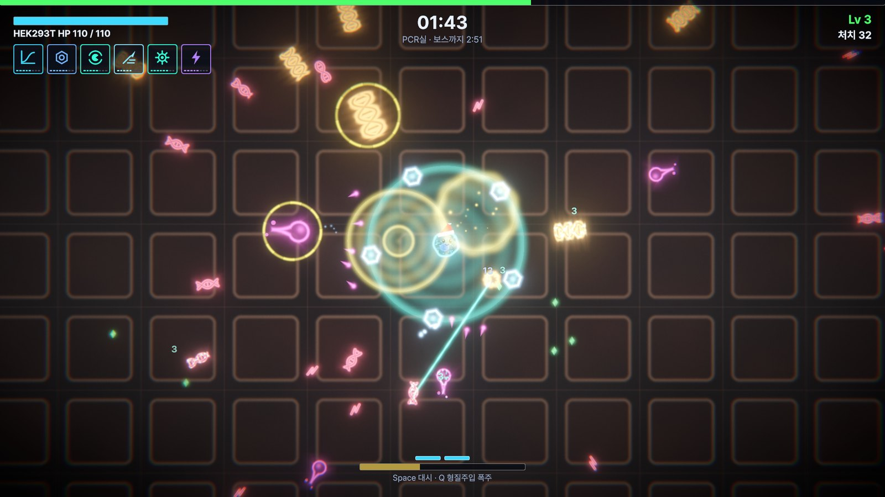 | 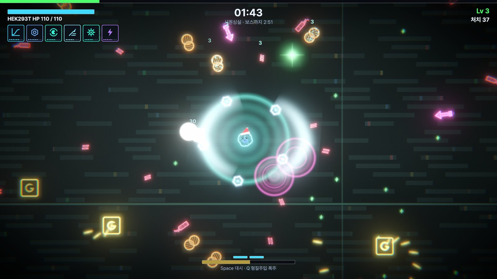 |
| 3구역 PCR실 — 달아오르는 히팅 블록 | 4구역 시퀀싱실 · 숏리드 |
| 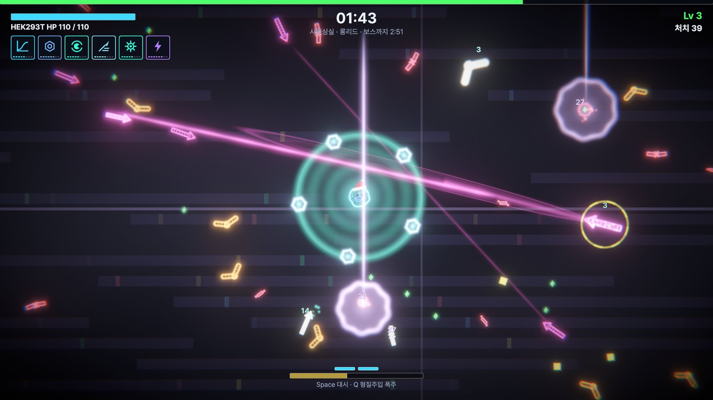 | 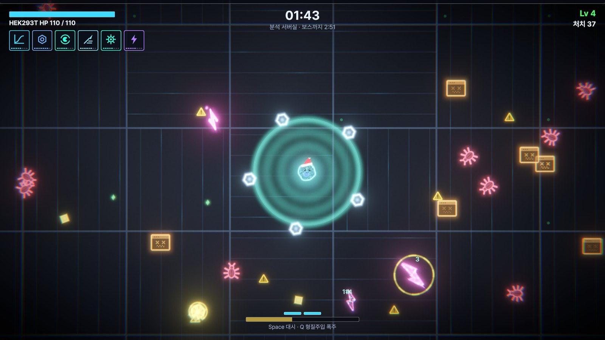 |
| 4구역 시퀀싱실 · 롱리드 | 5구역 분석 서버실 |
| 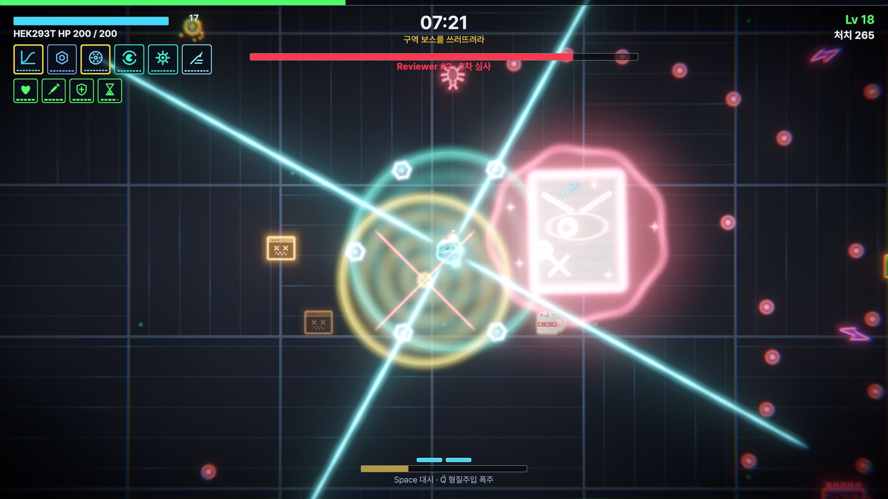 | 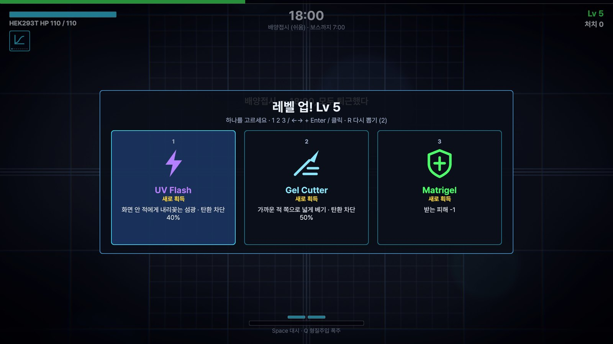 |
| 최종 보스 Reviewer #2 — 2차 심사 | 레벨업 3택 1 |
| 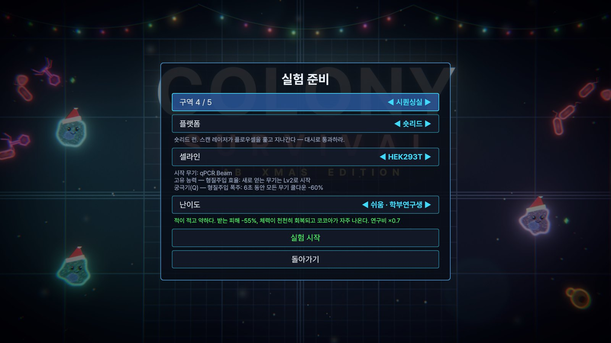 | 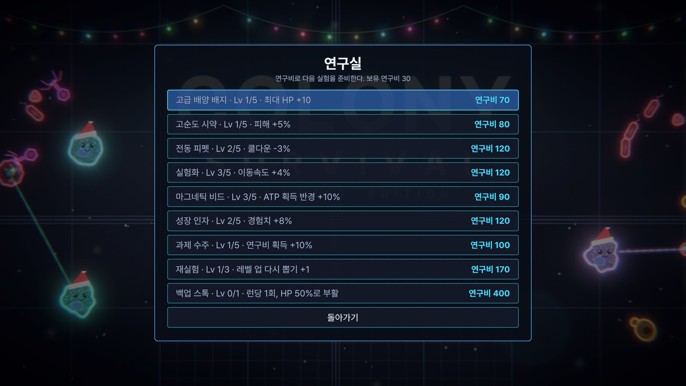 |
| 실험 준비 (구역·셀라인·난이도) | 연구실 (영구 강화) |

## 게임 방법

- **이동과 대시만 하세요.** 공격은 무기마다 쿨다운에 맞춰 자동으로 나갑니다.
- 적이 떨어뜨린 **ATP(초록 결정)** 를 주워 레벨업 → 새 무기 / 무기 강화 / 시약 중 하나를 고릅니다 (R로 다시 뽑기).
- **대시(Space)** 는 짧게 튀어 나가며 그동안 무적입니다. 게이지가 차면 **Q**로 셀라인 고유의 궁극기를 씁니다.
- 일부 무기는 **적의 탄환을 확률로 지웁니다** (Nanopore Ring 75%, Centrifuge Wave 60% 등 — 도감에 표시).
- 팁 박스를 부수면 **핫코코아(HP 회복)** 나 볼텍스가 나오고, 엘리트·보스가 주는 **선물상자**에서 강화를 한꺼번에 얻습니다. 조건을 채우면 무기가 **진화**합니다.
- 구역 시간이 끝나면 **보스**가 나옵니다. 쓰러뜨리면 다음 구역이 열립니다.
- 런이 끝나면 **연구비**를 받아 연구실에서 영구 강화를 삽니다.

### 조작

| 입력 | 동작 |
| --- | --- |
| WASD / 방향키 / 게임패드 왼쪽 스틱 | 이동 |
| Space · 왼쪽 Shift / 게임패드 A · RT | 대시 |
| Q · E / 게임패드 Y · LT | 궁극기 |
| 1 · 2 · 3 / ←→ + Enter / 마우스 | 레벨업 선택 |
| R | 선택지 다시 뽑기 |
| Esc / P | 일시정지 |
| F11 (Windows) · ⌘ + Ctrl + F (Mac) | 전체화면 (설정에도 있음) |

### 색의 의미

형광현미경처럼 색이 곧 규칙입니다.

| 색 | 의미 |
| --- | --- |
| 파랑·시안 (DAPI) | 나와 내 무기 |
| 초록 (GFP) | 주울 것 — ATP, 선물상자 |
| 빨강·주황·마젠타 (mCherry) | 적, 적의 공격 |
| 노랑 (YFP) | 곧 공격이 온다는 경고, 엘리트 (3~5구역에서는 경고가 공격하는 적의 색으로 뜹니다) |

## 캠페인

| 구역 | 기믹 | 나오는 것 | 보스 |
| --- | --- | --- | --- |
| 1. 배양접시 | 기본기를 익히는 넓은 접시 | 오염균 | **Mold Wreath** (곰팡이 화환) |
| 2. 클린벤치 | 층류가 아래로 밀고, UV 램프가 작업대를 쓸고 지나감 | 오염균 | **Krampus Phage** |
| 3. PCR실 | 히팅 블록이 온도 사이클에 맞춰 달아오름 | PCR 산물 | **Reviewer #1** — Minor Revision |
| 4. 시퀀싱실 | **숏리드**(스캔 레이저) 또는 **롱리드**(구역을 가로지르는 긴 리드) 중 선택 | 시퀀싱 아티팩트 | **Adapter Dimer** / **Concatemer** |
| 5. 분석 서버실 | 데이터 패킷이 타일 이음매를 따라 달림 | 서버 오류 | **Reviewer #2** — 체력을 다 깎으면 2차 심사 시작 |

방마다 그 방에서 생길 법한 것들이 적으로 나오고, 공격 방식도 서로 다릅니다.

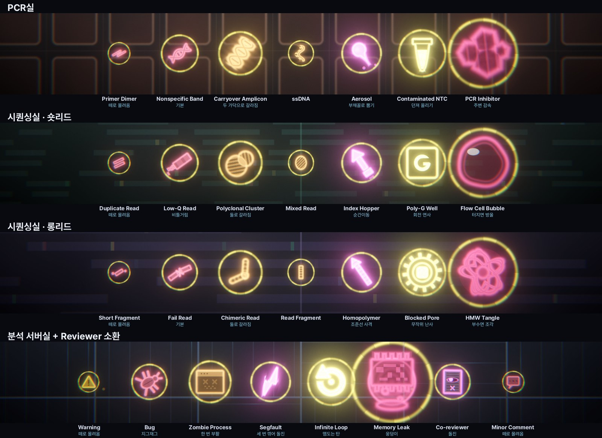

## 콘텐츠

| 항목 | 내용 |
| --- | --- |
| 셀라인 3종 | **HEK293T** (새 무기가 Lv2로 시작 · 궁극기 형질주입 폭주) · **HeLa** (불멸화: 한 번 부활 · 궁극기 무한 증식) · **RAW 264.7** (적을 처치하면 회복 · 궁극기 포식 폭발 — 1구역 클리어로 해금) |
| 무기 10종 + 진화 4종 | qPCR Beam, Gel Cutter, CRISPR Lance, Lentiviral Orb, Nanopore Ring, Lysozyme Field, 70% EtOH Splash, UV Flash, Antibody Chain, Centrifuge Wave → Real-time Thermocycler · Prime Editor · Pandemic Vector · Ultracentrifuge |
| 시약(패시브) 8종 | FBS, Pen-Strep, Trypsin, Agarose, DMSO, Matrigel, EGF, Lipofectamine |
| 적 32종 + 엘리트 | 오염균 6 · PCR 산물 6 · 숏리드 아티팩트 6 · 롱리드 아티팩트 6 · 서버 오류 6 · Reviewer가 불러내는 것 2 |
| 보스 6종 | Mold Wreath · Krampus Phage · Reviewer #1 · Adapter Dimer · Concatemer · Reviewer #2 (2단계) |
| 난이도 3단계 | 쉬움(학부연구생) · 보통(대학원생) · 어려움(리뷰어 모드, 연구비 ×1.5) |
| 연구실 영구 강화 9종 | 최대 HP, 피해, 쿨다운, 이동속도, ATP 획득 반경, 경험치, 연구비, 다시 뽑기, 부활(백업 스톡) |
| 도감 | 만난 적·보스·무기·시약이 기록됩니다 |
| 언어 | 한국어 / English (설정에서 전환) |
| 설정 | 언어, 전체·음악·효과음 볼륨, 그래픽 단계(자동 포함 5단계), 전체화면 · 일시정지 메뉴에서 피해 숫자·화면 흔들림 |

## v2에서 달라진 점

v3.0.0은 Godot 4로 만든 v2를 **Unity 6로 처음부터 다시 만든** 버전입니다.

| | v2.0.1 | v3.0.0 |
| --- | --- | --- |
| 엔진 | Godot 4 | Unity 6 |
| 구성 | 15분 한 판 + 스테이지 2종 | 5구역 캠페인 (구역마다 기믹·적·보스가 다름) |
| 조작 | 이동 | 이동 + 대시 + 궁극기 |
| 적·보스 | 적 6종, 보스 3종 | 적 32종, 보스 6종 (Reviewer #2는 2단계) |
| 음악 | 런 음악 + 보스 음악 | 구역별 음악, 긴장도에 따라 악기가 겹쳐짐 |
| 언어 | 한국어 | 한국어 / English |
| Mac | 유니버설 1개 | Apple Silicon용 / Intel용 따로 |

### 이전 버전

이전 버전도 계속 받을 수 있습니다.

- [v2.0.1](https://github.com/CleanCham-lab/ColonySurvival/releases/tag/v2.0.1) — Godot 4판 (macOS 10.13 이상, 구형 Intel Mac 지원)
- [Conoly_v1.0.0](https://github.com/CleanCham-lab/ColonySurvival/releases/tag/Conoly_v1.0.0) — 2025년 12월 알파 (Python + pygame)

## 업데이트 기록

- **v3.0.0** (2026-11-22) — Unity로 다시 만든 5구역 캠페인판 공개
- **v2.0.1** (2026-11-13) — 구형 Intel Mac(2015 MacBook Pro 등)에서 실행하자마자 꺼지던 문제 수정
- **v2.0.0** (2026-11-13) — 전면 개편 버전 공개

## 저장 위치와 플레이 기록

- Windows: `%USERPROFILE%\AppData\LocalLow\CleanCham-lab\Colony Survival\`
- macOS: `~/Library/Application Support/CleanCham-lab/Colony Survival/`

`save.json`(진행 상황)과 `playlog.jsonl`(한 판의 요약: 구역, 난이도, 생존 시간, 피격 횟수 등)이 여기에 저장됩니다. 이 파일들은 내 컴퓨터에만 남고 어디로도 전송되지 않습니다.

## 제작

- 개발 · 음악 · 아트: **채승원 (Seung Won Chae)**
- 소속: 서울대학교병원 진단검사의학과 (Department of Laboratory Medicine, Seoul National University Hospital) · 서울대학교 암연구소 (Cancer Research Institute, Seoul National University)
- Email: csm0578@naver.com/snu.ac.kr

## 라이선스

- 게임 코드·그래픽·음악: [MIT License](LICENSE) © 2025-2026 Seung Won Chae
- 폰트: Pretendard © Kil Hyung-jin, SIL Open Font License 1.1 (`Assets/Resources/Fonts/Pretendard-OFL.txt`)
- 엔진: Unity 6
