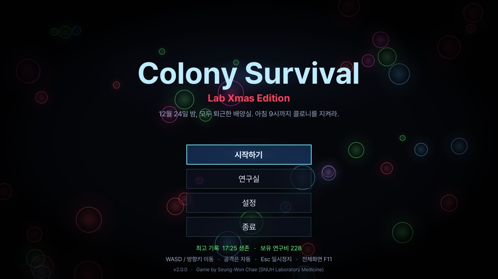
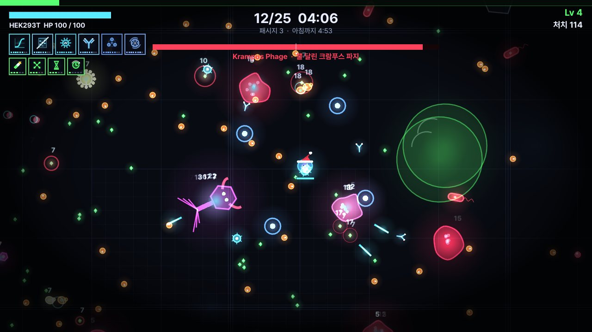
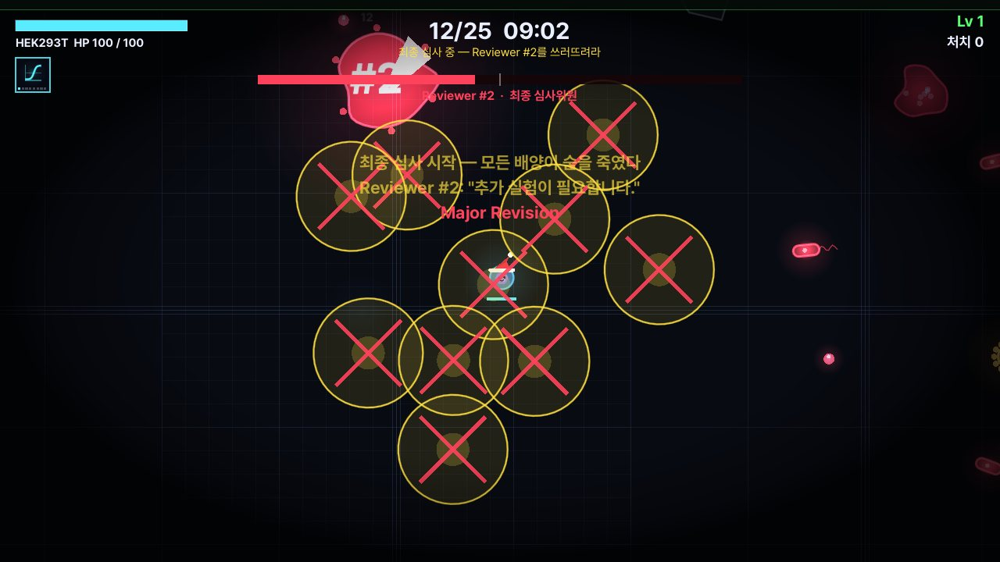
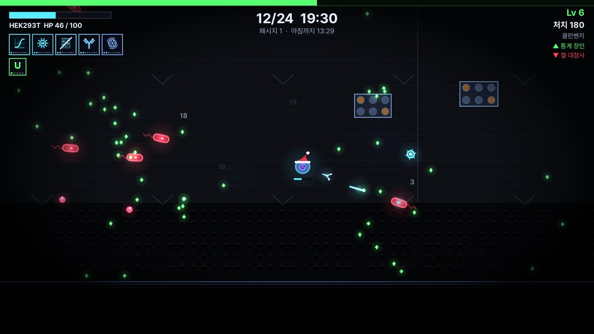
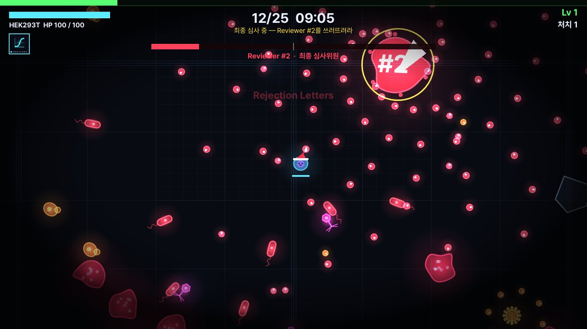
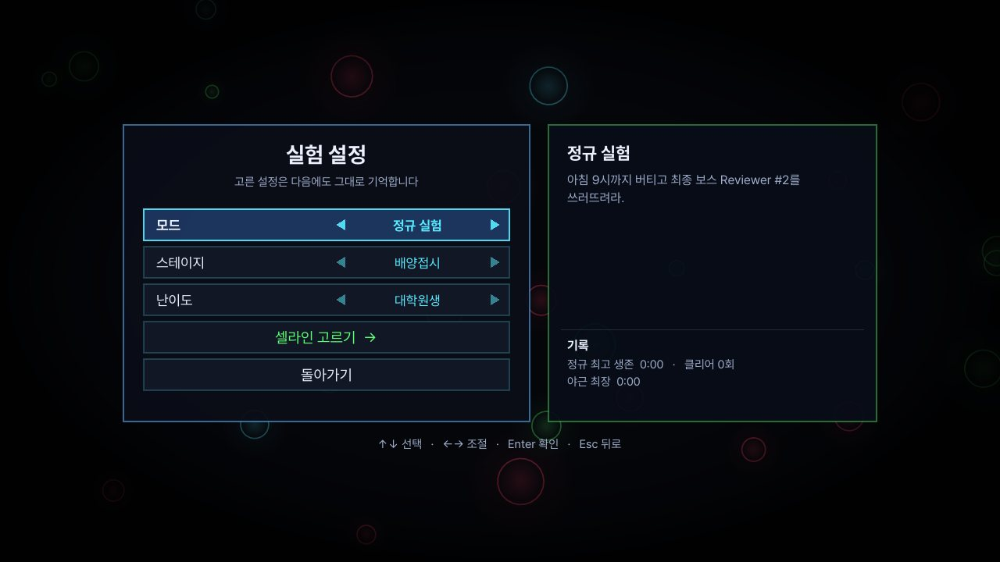
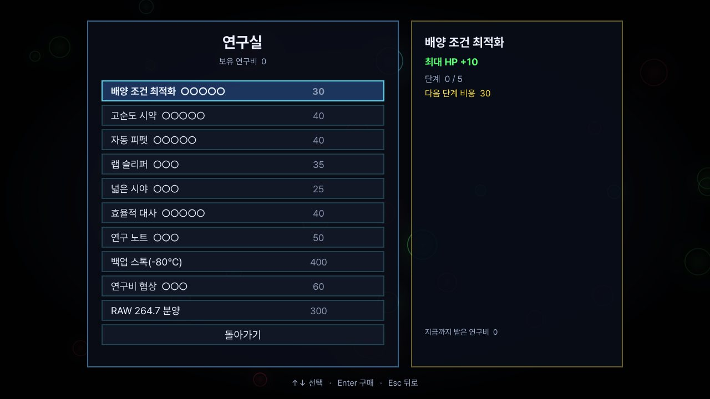

# Colony Survival — Lab Xmas Edition 🎄

**12월 24일 밤, 모두 퇴근한 배양실.**
아무도 배지를 갈아주지 않는 15시간(실제 15분) 동안 컨탐으로부터 콜로니를 지키고,
아침 9시에 도착하는 최종 심사위원 **Reviewer #2**를 쓰러뜨려라.

형광현미경 화면 속에서 펼쳐지는 자동공격 서바이벌 로그라이크입니다. 이동만 하면 무기는 알아서 쏘고, 레벨업마다 3개 중 하나를 골라 매판 다른 빌드를 만듭니다.

## 다운로드

**[Releases에서 최신 버전 받기](https://github.com/CleanCham-lab/ColonySurvival/releases/latest)** — Godot 같은 프로그램을 따로 설치할 필요가 없습니다.

| OS | 파일 | 실행 방법 |
| --- | --- | --- |
| Windows 10/11 | `ColonySurvival_v2.0.0_Windows.zip` | 압축 풀고 `ColonySurvival.exe` 더블클릭. 파란 "Windows의 PC 보호" 창이 뜨면 **추가 정보 → 실행** |
| macOS 10.13 이상 (Intel·Apple Silicon) | `ColonySurvival_v2.0.0_macOS.zip` | 압축 풀고 `Colony Survival.app` 더블클릭. "확인되지 않은 개발자" 경고가 뜨면 **시스템 설정 → 개인정보 보호 및 보안 → 그래도 열기** |

저장(연구비·해금·기록·설정)은 자동으로 됩니다.

## 스크린샷

| | |
| --- | --- |
|  |  |
| 플레이 화면 (10분 보스 크람푸스 파지) | 최종 보스 Reviewer #2 — Major Revision |
|  |  |
| 두 번째 스테이지 클린벤치 — UV 램프 경고 | Reviewer #2 마지막 패턴 — Rejection Letters |
|  |  |
| 실험 설정 (모드·스테이지·난이도) | 연구실 (영구 강화) |

## 게임 방법

- **이동만 하세요.** 공격은 무기마다 쿨다운에 맞춰 자동으로 나갑니다.
- 적이 떨어뜨린 **ATP(초록 구슬)** 를 주워 레벨업 → 새 무기 / 무기 강화 / 시약 중 하나 선택 (R로 다시 뽑기).
- 엘리트·보스가 떨어뜨리는 **선물상자**에서 강화를 한꺼번에 얻고, 조건을 채우면 무기가 **진화**합니다.
- 5분마다 보스가 나오고, 아침 9시(15분)에 **Reviewer #2**를 쓰러뜨리면 클리어.
- 런이 끝나면 **연구비**를 받아 연구실에서 영구 강화를 삽니다.

### 조작

| 입력 | 동작 |
| --- | --- |
| WASD / 방향키 / 게임패드 왼쪽 스틱 | 이동 |
| 1 · 2 · 3 / ↑↓ + Enter / 마우스 | 레벨업 선택 |
| R | 선택지 다시 뽑기 |
| Esc / P | 일시정지 (설정도 여기서) |
| F11 (Windows) · ⌘ + Ctrl + F (Mac) | 전체화면 |

### 색의 의미

형광현미경처럼 색이 곧 규칙입니다.

| 색 | 의미 |
| --- | --- |
| 파랑·시안 (DAPI) | 나와 내 무기 |
| 초록 (GFP) | 주울 것 — ATP, 선물상자 |
| 빨강·마젠타 (mCherry) | 적, 적의 공격 |
| 노랑 (YFP) | 곧 공격이 온다는 경고, 엘리트 |

설정 → **색 구분 모드 "색각 친화"** 를 켜면 파랑 = 나, 노랑 = 주울 것, 주황 = 적, 흰색 = 경고로 바뀝니다.

## 콘텐츠

| 항목 | 내용 |
| --- | --- |
| 셀라인 3종 | **HEK293T** (새 무기가 Lv2로 시작) · **HeLa** (불멸화: 한 번 부활) · **RAW 264.7** (대식세포, 처치하면 회복 — 클리어 또는 연구실에서 해금) |
| 무기 10종 + 진화 4종 | qPCR Beam, Gel Cutter, CRISPR Lance, Lentiviral Orb, Nanopore Ring, Lysozyme Field, 70% EtOH Splash, UV Flash, Antibody Chain, Centrifuge Wave → Real-time Thermocycler · Prime Editor · Pandemic Vector · Ultracentrifuge |
| 시약(패시브) 8종 | FBS, Pen-Strep, Trypsin, Agarose, DMSO, Matrigel, EGF, Lipofectamine |
| 적 6종 + 엘리트 | Mycoplasma, E. coli, Yeast(분열), Phage T4(돌진), Aspergillus(탄막), Biofilm(탱커) |
| 보스 3종 | 5분 **Mold Wreath**(곰팡이 화환) · 10분 **Krampus Phage** · 15분 최종 **Reviewer #2** (Major Revision / 추가 실험 / Desk Reject / Rejection Letters) |
| 모드 3종 | **정규 실험** (15분 + 최종 보스) · **야근 모드** (끝없이, 5분마다 더 강한 보스) · **오늘의 실험 조건** (날짜마다 버프 1 + 디버프 1) |
| 스테이지 2종 | **배양접시** (혈구계산판 격자, 배지 방울, 깨진 커버글라스) · **클린벤치** (층류가 아래로 밀어내고 UV 램프가 주기적으로 작업대를 쓸고 지나감 — 적도 맞음) |
| 난이도 3단계 | 학부연구생 · 대학원생 · 리뷰어 모드 (연구비 ×1.5) |
| 연구실 영구 강화 10종 | HP, 피해, 쿨다운, 이동속도, 획득 반경, ATP, 다시 뽑기, 부활(-80℃ 백업 스톡), 연구비, RAW 264.7 분양 |
| 설정 | 전체·음악·효과음 볼륨, 색각 친화 모드, 화면 흔들림, 피해 숫자, FPS, 전체화면 |

## 알파 버전과 달라진 점

2025년 12월 알파(Python + pygame, [Conoly_v1.0.0](https://github.com/CleanCham-lab/ColonySurvival/releases/tag/Conoly_v1.0.0))를 **Godot 4로 처음부터 다시 만들었습니다.**

| | 알파 (2025.12) | v2.0.0 (2026.11) |
| --- | --- | --- |
| 엔진·배포 | Python + pygame, Mac은 Python 필요 | Godot 4, 더블클릭 실행 파일 |
| 공격 | 클릭마다 전 무기 동시 발사 | 무기별 자동 발사 |
| 성장 | 무기를 밟으면 자동 장착 | 레벨업 3택1 + 진화 + 영구 강화 |
| 적·보스 | 근접 추격 4종, 몸통 박치기 보스 | 행동이 다른 적 6종, 경고 표시가 있는 보스 패턴 |
| 버프·디버프 | 60종 정의, 실제 작동 안 함 | 시약 8종 + '오늘의 실험 조건'으로 재활용 |
| 저장 | 없음 | 연구비·해금·기록·설정 |
| 그래픽·소리 | 도형, Windows 한글 깨짐 | 형광현미경 아트, Pretendard 폰트, 새 음악·효과음 |

## 제작

- 개발: **채승원 (Seung-Won Chae)**
- 소속: 서울대학교병원 진단검사의학과 분자진단검사실 (Molecular Diagnostics Laboratory, Department of Laboratory Medicine, SNUH)
- Email: csm0578@naver.com/snu.ac.kr

## 라이선스

- 게임 코드·그래픽·음악의 저작권은 제작자에게 있습니다. (별도 오픈소스 라이선스는 아직 지정하지 않았습니다.)
- 폰트: Pretendard © Kil Hyung-jin, SIL Open Font License 1.1 (`assets/fonts/Pretendard-OFL.txt`)
